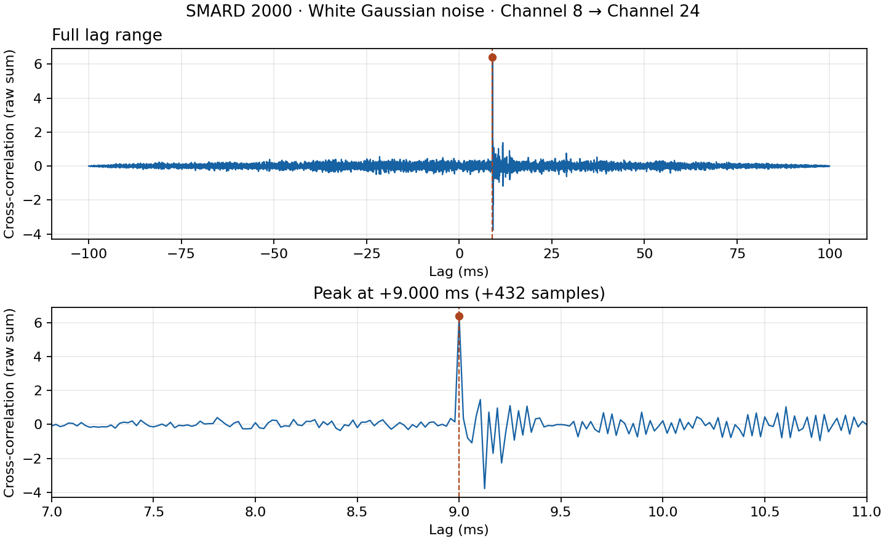

# estimate_delay

Estimate the delay of a recording relative to a reference by finding the peak of their time-domain cross-correlation.

## Signature

```python
from pyacdete.loudspeaker import estimate_delay

result = estimate_delay(x, y, fs)
```

## Parameters

<dl class="api-fields">
<dt id="param-x"><code>x</code> <span class="type">array-like</span></dt>
<dd><p>Reference signal, such as the electrical loopback of the loudspeaker drive.</p></dd>
<dt id="param-y"><code>y</code> <span class="type">array-like</span></dt>
<dd><p>Recording to compare with <code>x</code>, such as the microphone signal.</p></dd>
<dt id="param-fs"><code>fs</code> <span class="type">int or float</span></dt>
<dd><p>Positive finite sampling frequency in Hz, shared by both inputs.</p></dd>
</dl>

Both signals must be real one-dimensional arrays with at least two finite samples and some variation. They must share a time origin and sample clock. For two audio files, verify that their sample rates match and use the same start frame in each file. Signal lengths may differ. Invalid inputs or a correlation that overflows or vanishes at the supplied sample scale raise `ValueError`.

## Returns

The result is a dictionary.

| Key | Meaning |
|---|---|
| `lag_samples` | Signed integer lag at the first maximum of the correlation. Positive means `y` arrives after `x`. |
| `delay_seconds` | `lag_samples / fs`, in seconds. Multiply by 1,000 for milliseconds. |
| `lags_samples` | All integer lags from `1 - len(x)` through `len(y) - 1`, inclusive. |
| `correlation` | Raw cross-correlation sums at the corresponding lags, with `len(x) + len(y) - 1` entries. |

## Method and interpretation

Let $x_0$ and $y_0$ be the mean-subtracted signals. Samples outside each record contribute zero to the full linear correlation. The function evaluates the sums directly and finds the largest signed value.

$$
\begin{aligned}
R[k] &= \sum_n x_0[n] \, y_0[n+k], \\
\widehat{k} &= \operatorname*{arg\,max}_k R[k], \qquad \widehat{t} = \widehat{k}/f_s.
\end{aligned}
$$

This uses `scipy.signal.correlate(y0, x0, mode="full", method="direct")` and the corresponding `correlation_lags`. The peak estimates delay at one-sample resolution. Direct correlation takes work proportional to `len(x) * len(y)`, so use an excerpt that is much longer than the expected delay. Broadband excitation helps produce a distinct peak. Noise, narrowband signals and room reflections can make the peak less reliable or move it away from the first arrival.

## SMARD recording example

On the official Aalborg University download page, expand **0000/1000/2000** and choose **Download RAW data** for **Configuration 2000**. The `2000.zip` archive is about 407 MB. Inside `2000_20140121-1125`, select the white Gaussian noise recording (segment 7). The two files share the same excitation and recording clock. [SMARD downloads](https://www.es.aau.dk/research/audio-analysis-lab/smard/download) · [Direct raw archive](https://shares01.portal.aau.dk/smard/data/2000.zip)

| API input | File | Channel |
|---|---|---|
| `x` | `wgn_48kHz_ch8_DirLS.flac` | Ch. 8, directional loudspeaker electrical loopback |
| `y` | `wgn_48kHz_ch24_single_mic.flac` | Ch. 24, single microphone in the room |

Both files are 12-second mono FLAC recordings at 48,000 Hz. The example uses zero-based frames `48000:52800` from each file, which is the interval `[1.000, 1.100)` seconds. The script reads just the two selected members from the ZIP.

<div class="download-row"><a class="download" href="docs/downloads/pyacdete-0.2.0-py3-none-any.whl" download>Download Python wheel</a><a class="download secondary" href="docs/downloads/smard_delay.py" download>Download example script</a><a class="download secondary" href="docs/downloads/pyacdete-0.2.0.zip" download>Download package source</a></div>

```shell
python -m pip install "./pyacdete-0.2.0-py3-none-any.whl[smard]"
python smard_delay.py /path/to/2000.zip
```

For extracted FLAC files, read the same frame range in both channels and pass the arrays to the API.

```python
from pathlib import Path

import soundfile as sf
from pyacdete.loudspeaker import estimate_delay

folder = Path("2000_20140121-1125")
window = dict(start=48_000, frames=4_800, dtype="float64")
x, fs = sf.read(folder / "wgn_48kHz_ch8_DirLS.flac", **window)
y, fs_y = sf.read(folder / "wgn_48kHz_ch24_single_mic.flac", **window)
if fs != 48_000 or fs_y != fs or x.shape != (4_800,) or y.shape != (4_800,):
    raise ValueError("Expected two 4,800-frame mono windows at 48 kHz")

result = estimate_delay(x, y, fs)
print(result["lag_samples"], 1000 * result["delay_seconds"])
```

## Recorded result

```text
Estimated lag: +432 samples
Estimated delay: +9.000 ms
Peak correlation: 6.396123
Saved smard-delay-correlation.png
```

<figure class="result-figure"><a href="docs/assets/smard-delay-correlation.png"></a><figcaption>Direct cross-correlation of the loopback and microphone excerpts. The dashed line marks the maximum returned by the API.</figcaption></figure>

The microphone recording follows the loopback by 9.000 ms at the correlation peak. The positions in `setup.txt` place the speaker about 3.08 m from the microphone. At roughly 343 m/s in 20 °C air, that gives a travel time near 8.98 ms. The measured peak describes the complete loopback-to-microphone path, including acoustic and acquisition effects.

## References

1. C. H. Knapp and G. C. Carter, “The generalized correlation method for estimation of time delay,” *IEEE Transactions on Acoustics, Speech, and Signal Processing*, 24(4), 320–327, 1976. The introduction and Eqs. (2)–(3) describe delay estimation from the peak of a cross-correlation function. [DOI 10.1109/TASSP.1976.1162830](https://doi.org/10.1109/TASSP.1976.1162830)
2. SciPy documentation for the discrete sums and lag indices. [correlate](https://docs.scipy.org/doc/scipy/reference/generated/scipy.signal.correlate.html) · [correlation_lags](https://docs.scipy.org/doc/scipy/reference/generated/scipy.signal.correlation_lags.html)
3. J. K. Nielsen, J. R. Jensen, S. H. Jensen and M. G. Christensen, “The Single- and Multichannel Audio Recordings Database (SMARD),” *IWAENC*, 2014. [Dataset paper](https://www.aaudxp-cms.aau.dk/media/3yhdemt5/smardpaperiwaenc2014.pdf) · [Dataset](https://www.es.aau.dk/research/audio-analysis-lab/smard)
4. OpenStax, *University Physics Volume 1*, §17.2. [Speed of Sound](https://openstax.org/books/university-physics-volume-1/pages/17-2-speed-of-sound)
